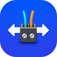
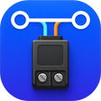

# ESP-Brookesia Factory Firmware

[](https://github.com/espressif/esp-idf/releases/tag/v5.5.5)
[](https://www.espressif.com/en/products/socs/esp32-p4)
[](https://lvgl.io/)

English | [简体中文](README_ZH.md)

This directory contains the ESP-Brookesia firmware source for the
**Waveshare ESP32-P4-WIFI6-Touch-LCD-7B**. It supports the display, touch,
audio, camera, SD card and ESP32-C6 Hosted Wi-Fi, and adds 7B-specific RS485
and CAN/TWAI terminal applications.

## Platform

| Item | Configuration |
| --- | --- |
| SoC | ESP32-P4 , 32 MiB flash, octal PSRAM (250 MHz) |
| Display / touch | 7-inch EK79007 1024 x 600 MIPI-DSI panel, GT911 capacitive touch |
| Framework | ESP-IDF v5.5.5; `main/idf_component.yml` requires `>=5.5,<6.0` |
| UI | LVGL 9.5.0, local ESP-Brookesia core 0.6.0-beta2 |
| Board support | Local BSP `esp32_p4_wifi6_touch_lcd_7b` 3.0.0 and `bsp_extra` |
| LVGL adapter | `espressif/esp_lvgl_adapter` 0.6.3 |
| Wireless | ESP32-C6 running ESP-Hosted 1.4.7 / `esp_wifi_remote` 0.14.5 over 4-bit SDIO |
| Voice assistant | `espressif/esp_xiaozhi` 0.1.1, ESP-SR 2.4.7, xiaozhi-fonts 1.6.0 |

The display, touch, ES8311, ES7210, SD card, camera and backlight are provided
by the local BSP and `bsp_extra`. See
[ESP32-P4 revision configuration](../../docs/ESP32P4_REVISION_CONFIG.md) for
silicon profiles, and [Firmware and CI packages](../../docs/firmware.md) for
how firmware images differ from CI artifacts.

## Applications

<table>
  <tr>
    <td align="center"><br><b>DrawPanel</b></td>
    <td align="center"><br><b>Squareline</b></td>
    <td align="center"><br><b>Calculator</b></td>
    <td align="center"><br><b>SpecAnalyzer</b></td>
    <td align="center"><br><b>MusicPlayer</b></td>
    <td align="center"><br><b>Camera</b></td>
  </tr>
  <tr>
    <td align="center"><br><b>VideoPlayer</b></td>
    <td align="center"><br><b>RS485</b></td>
    <td align="center"><br><b>CAN</b></td>
    <td align="center"><br><b>Settings</b></td>
    <td align="center"><br><b>AIChats</b></td>
  </tr>
</table>

| Application | Function | Runtime requirements |
| --- | --- | --- |
| DrawPanel | Fixed canvas; drawing near the edges does not drag the app | Display and touch |
| Squareline | Registry-installed Squareline Studio UI demo and app template | Display and touch |
| Calculator | Touch-friendly Brookesia calculator | Display and touch |
| SpecAnalyzer | FFT spectrum of the MIC1/MIC2 microphones | ES7210 TDM input |
| MusicPlayer | Plays local MP3 files from `/spiffs/music` with a spectrum view | SPIFFS `storage`, ES8311 output |
| Camera | OV5647 MIPI CSI preview, rotated 90 degrees by the PPA to fit the landscape panel | OV5647, `esp_video` |
| VideoPlayer | Full-screen AVI/MJPEG playback from the SD card, with audio when available | SD card, JPEG/PPA, ES8311 output |
| RS485 | UART1 RS485 terminal; sends a greeting automatically by default | On-board automatic-direction transceiver |
| CAN | 500 kbit/s TWAI terminal; reports bus state and requests recovery after BUS_OFF | On-board TJA1051 |
| Settings | WLAN scan/connect, sound, screen brightness and device information | ESP32-C6 Hosted Wi-Fi and board services |
| AIChats | Network check, Xiaozhi activation, WakeNet wake word, AEC/VAD, Opus uplink/downlink, server text, emotions and TTS | Wi-Fi, `model`/`storage` images, ES8311, ES7210 |

## Build

### Requirements

You need ESP-IDF v5.5.5, the `esp32p4` toolchain and network access to the ESP
Component Registry. Use a USB cable that supports data transfer for flashing.
Run all commands below from this directory.

`build*/`, `managed_components/` and `dependencies.lock` are generated locally;
the first build downloads managed dependencies from the component manifests.
When copying the source project, keep `main/`, `components/`, `spiffs/`,
`sdkconfig.defaults*` and `partitions.csv` together.

### Silicon profiles

Each silicon revision uses its own `sdkconfig.defaults.*` file and build
directory. The resulting images must not be mixed:

| Profile | Hardware | Key differences |
| --- | --- | --- |
| `rev3_x` | ESP32-P4 Rev3.x (delivered configuration) | Rev3.x MIPI PHY reference clock, 250 MHz PSRAM |
| `rev3_2` | Rev3.2 with dual UART0 and USB Serial/JTAG logging | Revision range 3.1-3.99; not yet tested on physical Rev3.2 hardware |
| `rev1_3` | Rev1.3 test boards | Pre-v3 silicon, legacy MIPI PHY clock, 200 MHz PSRAM; must not be flashed to Rev3.x |

Rev3.x:

```sh
idf.py -B build-v5.5.5-rev3_x -D SDKCONFIG="$PWD/build-v5.5.5-rev3_x/sdkconfig" -D SDKCONFIG_DEFAULTS="sdkconfig.defaults;sdkconfig.defaults.rev3_x" build
```

Rev1.3:

```sh
idf.py -B build-v5.5.5-rev1_3 -D SDKCONFIG="$PWD/build-v5.5.5-rev1_3/sdkconfig" -D SDKCONFIG_DEFAULTS="sdkconfig.defaults;sdkconfig.defaults.rev1_3" build
```

Rev3.2 with dual logging:

```sh
idf.py -B build-v5.5.5-rev3_2-dual-log -D SDKCONFIG="$PWD/build-v5.5.5-rev3_2-dual-log/sdkconfig" -D SDKCONFIG_DEFAULTS="sdkconfig.defaults;sdkconfig.defaults.rev3_2" build
```

The Rev1.3 profile disables both touch X/Y mirror flags, rotating touch
coordinates by 180 degrees relative to the previous firmware; display rotation
is unchanged. The maintainer confirmed this correction on Rev1.3 hardware.

### First full flash and partition changes

The first installation must write the bootloader, partition table,
application, ESP-SR models and SPIFFS resources (Rev3.x shown):

```sh
idf.py -B build-v5.5.5-rev3_x -p PORT flash monitor
```

After changing partition offsets or sizes, upgrading from an older partition
layout, or when stale model or file-system images are suspected, erase the
flash before a full flash:

```sh
idf.py -B build-v5.5.5-rev3_x -p PORT erase-flash flash monitor
```

If the partitions, speech models and `spiffs/` resources are unchanged, you can
flash only the application:

```sh
idf.py -B build-v5.5.5-rev3_x -p PORT app-flash monitor
```

`app-flash` does not update `srmodels.bin`, `storage.bin` or the partition
table. After changing `partitions.csv`, the WakeNet/model Kconfig,
xiaozhi-fonts, the bundled music or the prompts, run a full `flash` again.

### Merge the factory image

After a successful build, create the dated FactoryOnly image:

```sh
mkdir -p ../../releases/factory_firmware
(cd build-v5.5.5-rev3_x && python -m esptool --chip esp32p4 merge_bin -o ../../../releases/factory_firmware/ESP32-P4-WIFI6-Touch-LCD-7B-FactoryOnly-260820.bin @flash_args)
```

The merged image is 16 MiB and is written from offset `0x0`. Compilation and
image validation do not replace flashing or on-hardware testing.

## AIChats / Xiaozhi

AIChats uses `esp_xiaozhi` for the protocol; this project handles the UI,
activation, audio and lifecycle integration.

First use:

1. Configure WLAN in Settings.
2. Open AIChats. If the device is not bound to an account, it shows and reads
   out an activation code.
3. Add the device in the Xiaozhi console and enter the activation code.
4. Once the page is in standby, say the wake word (default "你好小智",
   "Ni Hao Xiao Zhi") or tap the emoji to start a conversation.

Interaction:

- In standby, tap the emoji to start a turn. While waiting for activation, tap
  the activation code to read it out again. Taps during a turn do not
  interrupt it; use the wake word to interrupt playback.
- Closing AIChats disconnects from the server and reopening reconnects
  automatically. Pausing (switching to another app) keeps the connection.

If the log shows `Speech model partition 'model' is missing` or
`Speech model image is empty or unreadable`, rebuild and run a full flash so
the partition table and `srmodels.bin` are written to the device.

The local UI language and transport are configured in:

```text
idf.py menuconfig
  Xiaozhi Application
    Local UI language            English / Simplified Chinese
    Preferred Xiaozhi transport  WebSocket (default) / Auto / MQTT+UDP
```

The UI language option only controls the firmware's built-in text; it does not
translate conversations, TTS or activation messages returned by the server.
Local strings are in `components/XiaozhiApp/XiaozhiLocalization.*`.

The board uses the ES8311 for audio output and the ES7210 for input. In voice
mode the I2S bus runs at 24 kHz, 16-bit, and the ES7210 outputs 4-slot TDM in
the order `[MIC1, MIC3 (echo reference), MIC2, MIC4]`. AIChats takes MIC1,
MIC2 and the echo reference, resamples them to 16 kHz and feeds the AFE in the
`MMR` layout with AEC enabled to cancel playback echo, then encodes 16 kHz mono
Opus for the uplink. Downlink Opus from the server is decoded directly at
24 kHz for output.

## Board hardware

### Display and touch

The 7B display path is fixed to its own panel parameters and must not use the
LCD-X timing values:

| Panel | Resolution | MIPI-DSI lanes | Lane rate | DPI clock |
| --- | --- | ---: | ---: | ---: |
| EK79007 | 1024 x 600 | 2 | 1000 Mbps/lane | 52 MHz |

The local BSP selects `MIPI_DSI_PHY_PLLREF_CLK_SRC_DEFAULT` for Rev3.x. The
pre-v3 compatibility branch uses the legacy `MIPI_DSI_PHY_CLK_SRC_DEFAULT`, but
the delivered configuration sets `CONFIG_ESP32P4_REV_MIN_300=y` and does not
enable `CONFIG_ESP32P4_SELECTS_REV_LESS_V3`.

GT911 RESET is `GPIO23` and its INT signal is not connected (`GPIO_NUM_NC`).
The BSP probes I2C address `0x5D`, then `0x14`, and reads touch data by polling.

### RS485 and CAN

| Application | Pins and configuration | Board behavior |
| --- | --- | --- |
| RS485 | UART1: GPIO27 TX, GPIO26 RX, 115200 8N1 | The on-board automatic-direction transceiver needs no RTS/DE GPIO. Automatic greeting transmission is enabled by default. |
| CAN | GPIO22 TX, GPIO21 RX; 500 kbit/s normal mode | Uses the on-board TJA1051. Automatic transmission is disabled by default; the app reports bus state and requests recovery after BUS_OFF. |

### Power domain

VO4 supplies the complete GPIO39-GPIO48 VDD_IO_5 bank. The board uses
GPIO39-GPIO44 for SDMMC and GPIO45 for active-low card-power control;
GPIO46-GPIO48 remain in the same bank. The local BSP owns and enables that
3.3 V LDO once. RS485 and CAN use fixed `ESP_3V3` domains and do not depend on
VO4.

### Serial ports and logging

UART0 uses GPIO37 TX / GPIO38 RX, 115200 baud, 8N1 and no flow control. Use H1,
labeled `Type-C UART`, for the CH343P USB-to-UART path, or H2, labeled
`USB1.1 Type-C`, for native USB Serial/JTAG (GPIO25 D+ / GPIO24 D-). J1 is the
separate USB-A/USB OTG connector and is not a console output.

The `rev3_2` profile mirrors application INFO/WARN/ERROR output to native USB
Serial/JTAG; open the matching serial port before resetting the board to
capture startup. The bootloader logs at WARN level to keep the existing 24 KiB
slot, and the USB secondary console starts with the application, so it does
not mirror bootloader logs.

## Camera and media

Camera uses the OV5647 MIPI RAW8 800 x 640, 50 FPS binned mode, the same mode
as the LCD-7C; the 800 x 1280 mode shows a strong colour cast. The PPA scales
the landscape frame up to cover the panel. Because the scale factor is
quantised to 1/16 steps, the firmware picks a factor and crop for which the
scaled output exactly fills the 1024 x 600 panel; the top and bottom of the
picture are cropped. A portrait sensor mode is rotated by 90 degrees instead.

VideoPlayer scans only `/sdcard/avi`; the `.avi` extension is matched
case-insensitively. AVI and MP4 files in the SD card root are not listed. The
player reads AVI with `avi_player`, decodes MJPEG with the JPEG decoder,
scales it with the PPA and writes to the LCD frame buffer. If audio
initialization fails, playback continues without sound.

MusicPlayer reads MP3 files from `/spiffs/music`; the project ships with five
tracks. After changing tracks, regenerate and flash `storage.bin`; `app-flash`
alone does not apply the change.

## Development notes

- The MCP tool entry point is `registerXiaozhiDeveloperTools()` in
  `components/XiaozhiApp/XiaozhiDeveloperTools.cpp`; it registers no tools by
  default. The WebSocket task in `esp_xiaozhi` 0.1.1 has only a 4 KB stack and
  handles MCP messages, so resolve the stack size first before registering
  tools, otherwise `tools/list` serialization overflows the stack.
- New apps derive from `esp_brookesia::systems::phone::App`, implement `run()`
  and `back()`, and override other lifecycle functions according to the
  resources they own.
- Only touch LVGL objects on the LVGL thread or while briefly holding the
  display lock. When an app closes, release its timers, tasks, queues, codec
  session, SD handles and LVGL objects.
- Audio reads and writes in `bsp_extra` use separate input and output locks;
  both are held only while the codec is reconfigured, so full-duplex apps such
  as AIChats can capture and play at the same time.
- During playback, VideoPlayer enables the adapter's Dummy Draw and pauses
  LVGL; on exit it stops `avi_player` and then resumes LVGL drawing.

## Project structure

| Path | Responsibility |
| --- | --- |
| `CMakeLists.txt` | ESP-IDF project entry |
| `main/main.cpp` | Initializes the Phone system, installs apps and handles Wi-Fi status events |
| `main/CMakeLists.txt` | Stages `spiffs/` and the Xiaozhi font into the `storage` partition image |
| `components/brookesia_core/` | Local Brookesia core implementation |
| `components/esp32_p4_wifi6_touch_lcd_7b/` | Local 7B BSP (display, touch, SD card, power domain) |
| `components/bsp_extra/` | Audio codecs, Wi-Fi service and board peripheral extensions |
| `components/{brookesia_app_calculator, brookesia_app_squareline_demo, draw, Camera, XiaozhiApp, VideoPlayer, MusicPlayer, SpecAnalyzer, Settings, HardwareApps}/` | Launcher apps: calculator, Squareline demo, drawing, camera, Xiaozhi, video, music, spectrum, settings and RS485/CAN |
| `spiffs/` | Music and Xiaozhi prompts for the `storage` partition image |
| `partitions.csv` | Flash partition layout |
| `sdkconfig.defaults*` | Project defaults and silicon profiles |

## Notes

- Use the LVGL lock only for UI work; run networking, SD scanning, audio
  initialization, NVS and model loading outside the lock.
- Changes to models, fonts, prompts, music or partitions require a full
  `flash`.
- Several audio apps share the same physical bus; stop or hand over the codec
  session when switching apps.
- Host components must match the co-processor firmware on the ESP32-C6.
  `esp_wifi_remote` and `esp_hosted` are pinned; confirm the co-processor
  firmware before upgrading them.
- Compilation and image validation do not test the panel, touch, RS485
  automatic direction or peer, CAN peer acknowledgement/termination, or
  physical BUS_OFF recovery.

`EXAMPLE_SHOW_MEM_INFO = true` in `main/main.cpp`, so SRAM/PSRAM usage is
sampled periodically. Detailed statistics logging is controlled separately by
`EXAMPLE_SHOW_MEM_INFO_LOG`.

When reporting an issue, include the board and silicon revision, the ESP-IDF
version, complete reproduction steps and the first real error in the log.

The local Brookesia core is licensed under the
[Apache-2.0 license](components/brookesia_core/license.txt), which applies only
to that component. Code in `components/XiaozhiApp/third_party/xiaozhi_esp32/`
is covered by the MIT license in its directory.
